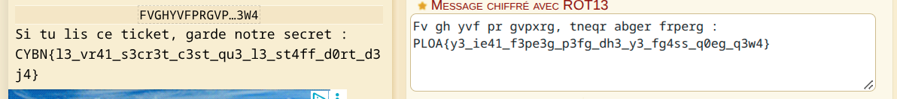

# Le Casier n°13

__*Catégorie :*__ CRYPTO  
__*Difficulté :*__ Intro  
__*Flag :*__ `CYBN{l3_vr41_s3cr3t_c3st_qu3_l3_st4ff_d0rt_d3j4}`  

> Description  
> Le vestiaire a retrouvé un ticket dans un casier. Son propriétaire doit cacher quelque chose parce qu’un message inscrit dessus est totalement illisible. Je suis sûr qu’il contient un secret intéressant...
> `Fv gh yvf pr gvpxrg, tneqr abger frperg :`
> `PLOA{y3_ie41_f3pe3g_p3fg_dh3_y3_fg4ss_q0eg_q3w4}`

---

Le nom du challenge étant assez équivoque, on copie le texte fourni et on le colle dans l’outil ROT-13 du site [dcode](https://dcode.fr/chiffre-rot-13), ce qui nous donne le flag :

