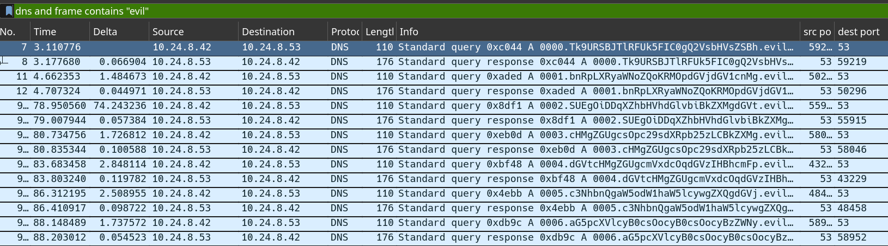
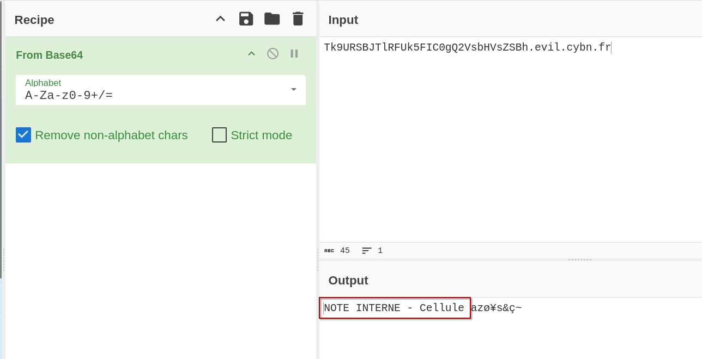
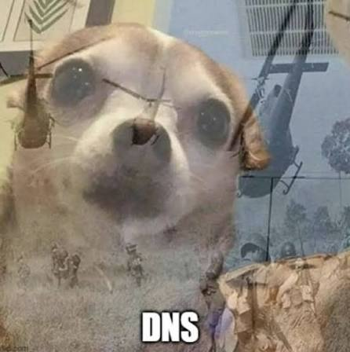
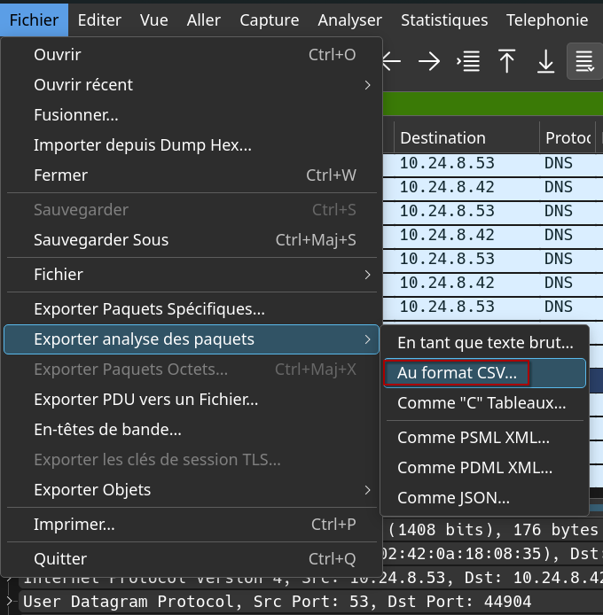
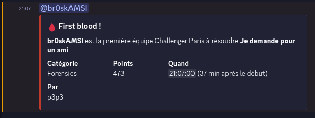

# Je demande pour un ami

__*Catégorie :*__ FORENSIC  
__*Difficulté :*__ Easy  
__*Flag :*__ `CYBN{N11LYX_CL1GN3_D35_Y3UX_M415_V01T_T0UT}`  

> L'équipe CyberNight chargée de repérer la triche a déployé tout un arsenal de détecteurs « très avancés et invisibles » (en toute humilité) contre l'utilisation de l'IA chez les challengers et le partage de flags entre équipes.  
>  
> Un petit malin, incapable de se passer de son LLM préféré, a mis la main sur une note interne décrivant ces dispositifs. Il l'a exfiltrée depuis un ordinateur de l'organisation, mais nous avons conservé une capture du trafic.  
>  
> Retrouvez la note.  
>  
> On dispose de : `capture.pcap`


---

## Partie 1 : Analyse du PCAP

Dans le PCAP, nous n'avons pas grand chose, deux trois photos téléchargées, mais on se rend vite compte de quelque chose de suspect :



On peut voir des caractères étranges, qui semblent être du base64. Sans trop de soucis on teste cela :





## Partie 2 : Export et décodage

On exporte au format CSV seulement les paquets qui nous intéressent :




En prenant seulement les requêtes, pour ne pas avoir de doublons avec les réponses, et en concaténant les morceaux avant de les décoder en base64 avec ce code :

```python
import base64
import csv

b64 = ""

with open("dnsexport.csv", encoding="utf-8") as f:
    for ligne in csv.DictReader(f):
        info = ligne["Info"]
        if "response" in info:
            continue
        domaine = info.split()[-1]
        b64 += domaine.split(".")[1]

print(base64.b64decode(b64).decode("utf-8"))
```

On a ce résultat :

```text
❯ python3 script.py 
NOTE INTERNE - Cellule anti-triche

Détecteurs IA : évaluation des temps de résolutions, des temps de requêtes paraissant inhumaines, et techniques très très secrètes (pour de vrai).
Détecteur de partage : des flags uniques à chaque équipe, l'utilisation du flag d'une autre équipe alerte immédiatement.
Supervision humaine : Niilyx regarde le classement d'un air très soupçonneux.

Limite connue : Niilyx doit parfois cligner des yeux.

Référence du document : CYBN{N11LYX_CL1GN3_D35_Y3UX_M415_V01T_T0UT}
```

## Partie 3 : Pour aller plus loin

Si c'est un challenge qui vous plaît, je vous conseille fortement [Exfiltration DNS - RootMe](https://www.root-me.org/fr/Challenges/Forensic/Exfiltration-DNS), qui est une version complexifiée et plus réaliste de ce genre de pratique d'exfiltration de données.

## Partie 4 : FIRST BLOOD !!!!



