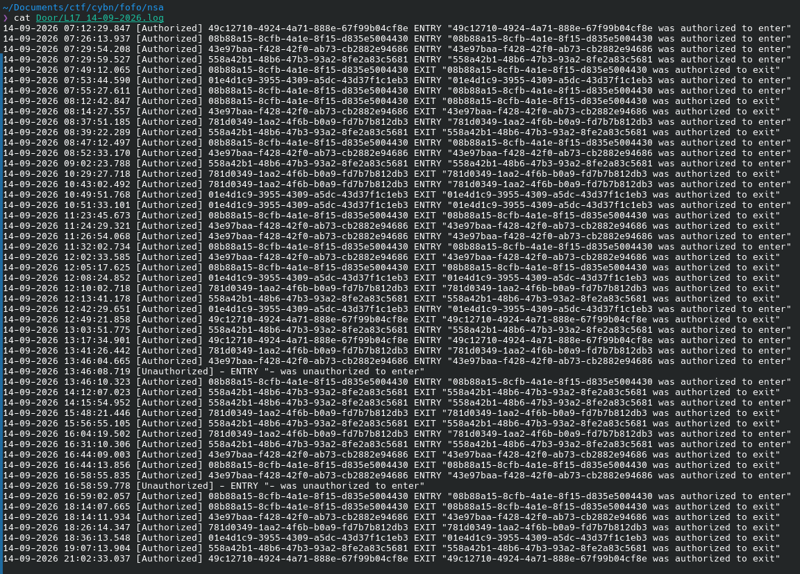

# Not Secured Access

__*Catégorie :*__ FORENSIC  
__*Difficulté :*__ Medium   
__*Flag :*__ `CYBN{Clément-TAL_NSA-J2XV2AHD_16:00}`  

> Mesdames, Messieurs, l'heure est grave.  
>  
> Notre organisation, la NSA, suspecte une malveillance interne. Un fichier sensible - accessible uniquement depuis les postes du 17e étage - a été retrouvé mis en vente sur le dark web. Ce dernier a par la suite été rendu public.  
>  
> Grâce à cette révélation publique, nous avons pu confirmer plusieurs choses :  
> - La crédibilité de la fuite : il s'agt bien du vrai fichier  
> - La date de la fuite : le contenu du fichier nous permet d'estimer précisément sa copie le jour du 14 septembre de cette année.  
>  
> Puisque une malveillance interne est suspectée, nous faisons appel à une entité externe pour analyser les différents éléments, et repérer le coupable.  
>  
> Tous les niveaux d'accréditation ne permettent pas d'accéder à ce fichier, et je doutez qu'un employé de chez nous ait été assez naïf pour effectuer ceci sur son propre poste. Nous ne recrutons que les meilleurs après tout.  
>  
> A vous d'identifier :  
> 1. Le nom du coupable  
> 2. Le nom du poste où le vol a été effectué  
> 3. Le moment approximatif où à eu lieu le vol, arrondi à la dizaine de minute la plus proche (eg. 12:27 -> 12:30 ; 18:56 -> 19:00 ; 09:42 -> 09:40)  
>  
> Format : `CYBN{Nom-COUPABLE_NOMPOSTE_hh:mm}`


---

Dans ce challenge, l'énoncé donne beaucoup d'indications. On dispose seulement des fichiers suivants :

```bash
❯ tree 
.
├── 050926_user_extract.xlsx
├── Badges - Marieland.xlsx
├── Door
│   └── L17_14-09-2026.log
├── DSI [CONFIDENTIAL] - Desktop asset list.xlsx
├── Endpoints
│   ├── NSA-3AV57F9L_14-09-2026.log
│   ├── NSA-BJAWKYRP_14-09-2026.log
│   ├── NSA-J2XV2AHD_14-09-2026.log
│   ├── NSA-PEMCOVPG_14-09-2026.log
│   ├── NSA-QGGLC4UZ_14-09-2026.log
│   └── NSA-R0GLWRMH_14-09-2026.log
├── NSA.zip
└── Planning 14-sept-26.png
```

Nous verrons au fur et à mesure à quoi sert chacun d'eux.

## Partie 1 : Qui dispose des accès ?

J'ai d'abord regroupé les trois fichiers Excel en un seul pour les avoir sous la main en permanence.


L'énoncé précise que seuls les badges suivants disposent des accréditations nécessaires, car leur niveau de confidentialité est supérieur à 1 :

- 38c16a31-4f9b-4809-ad6d-2806cbdd006f
- 682100a3-d499-44ec-b8ac-e12a4fafd480
- 614f0344-fc0b-4c55-9bb3-1ddc17ffaed2
- 49c12710-4924-4a71-888e-67f99b04cf8e
- 5d1c6f5e-ef89-4cc8-a1b6-c7d9e00cbb7c
- 397959c1-d586-46fb-9ae2-5edbfa5697f0
- 61f27273-cfe2-4c36-8a29-68a5e37ea346
- 781d0349-1aa2-4f6b-b0a9-fd7b7b812db3
- 2e3ccfc8-1695-491e-b19d-35b4b51963c5

## Partie 2 : Quand cela s'est-il passé ?

Pour chaque personne, on utilise le journal de la porte de l'étage (`Door/L17_14-09-2026.log`) pour savoir à quels moments elle se trouvait à l'étage :



Dans les fichiers Excel, on retrouve ensuite le PC et l'identifiant de session de chaque personne. On peut alors comparer ses heures de présence à l'étage avec l'activité de son poste.

Par exemple, BECKER Susan (badge `781d0349-1aa2-4f6b-b0a9-fd7b7b812db3`, identifiant `IOLFO5937`) se connecte toujours sur le PC `NSA-J2XV2AHD`.


Grâce au badge, on voit à quels moments elle entre à l'étage et le quitte :


Le journal de son PC montre l'activité de sa session. On remarque aussi que ce jour-là, chaque personne ne se connecte que sur son propre PC : aucun poste n'est utilisé par deux comptes différents.

```bash
❯ cat Endpoints/NSA-J2XV2AHD_14-09-2026.log    
datetime,action,user,status,msg  
14-09-2026 08:38:47.516,System boot,,success,,  
14-09-2026 08:39:29.204,Logon,IOLFO5937,success,,  
14-09-2026 08:39:29.731,Unlock,IOLFO5937,success,,  
14-09-2026 10:28:41.615,Lock,,success,,  
14-09-2026 10:44:18.392,Unlock,IOLFO5937,success,,  
14-09-2026 11:26:21.150,Lock,,success,,  
14-09-2026 11:29:22.808,Unlock,IOLFO5937,success,,  
14-09-2026 12:08:47.256,Lock,,success,,  
14-09-2026 12:38:47.746,Sleep,,success,,  
14-09-2026 13:42:35.271,Wake,,success,,  
14-09-2026 13:43:19.804,Unlock,IOLFO5937,success,,  
14-09-2026 15:46:57.481,Lock,,success,,  
14-09-2026 15:57:26.528,Unlock,IOLFO5937,success,,  
14-09-2026 16:03:04.261,Lock,,success,,  
14-09-2026 16:05:11.936,Unlock,IOLFO5937,success,,  
14-09-2026 18:19:38.527,Lock,,success,,  
14-09-2026 18:24:03.112,System shutdown,,success,,
```

D'après son badge, elle a brièvement quitté l'étage entre 15:48 et 16:04, juste après avoir verrouillé son poste (15:46:57) :


Pourtant, pendant son absence, le journal du PC montre que sa session a été déverrouillée avec son compte, puis verrouillée de nouveau :

```
14-09-2026 15:57:26.528,Unlock,IOLFO5937,success,,  
14-09-2026 16:03:04.261,Lock,,success,,
```

Quelqu'un d'autre a donc utilisé son ordinateur avec ses identifiants pendant environ 6 minutes, par exemple pour voler un fichier.

## Partie 3 : Qui ?

On connaît maintenant le créneau et le poste visé. Reste à savoir qui s'y est introduit.

Je passe sur le moment où j'ai dû reconstituer à peu près ce que faisait chacun, et à quelle heure. J'en ai conclu que trois utilisateurs étaient présents à l'étage pendant ce court déverrouillage. Parmi eux, Clément TAL a laissé son PC déverrouillé de 14h à 18h, peut-être pour se donner l'air de travailler...


## Partie 4 : Reconstitution du flag

Avec toutes ces informations on peut constituer le flag : 

```
CYBN{Clément-TAL_NSA-J2XV2AHD_16:00}
```

## Partie 5 : First blood

Même sous 5h du mat :

