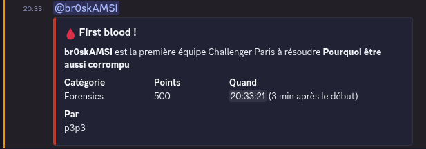

# Pourquoi être aussi corrompu

__*Catégorie :*__ FORENSIC  
__*Difficulté :*__ Intro  
__*Flag :*__ `CYBN{PH3N1X-02}`  

> Alerte générale ! Le site des challenges de la CyberNight ne répond plus ! La documentation indique quelle machine de secours utiliser... sauf que Niilyx a corrompu le DOCX en voulant le mettre à jour.  
>  
> Il est presque certain d'y avoir inséré une image avec l'information nécessaire. Retrouvez le nom de la machine de secours.  
>  
> Format : `CYBN{NOM_DE_LA_MACHINE}`


---

## Partie 1 : Extraction du DOCX

En tant que grand joueur de CTF (non), on sait qu'un fichier DOCX est en fait une archive ZIP: le texte, les styles et les images insérées y sont rangés dans des fichiers séparés. Même si le document ne s'ouvre plus dans Word, on peut donc en extraire l'image directement :

```bash
❯ unzip documentation.docx    
Archive:  documentation.docx  
 inflating: [Content_Types].xml        
 inflating: _rels/.rels                
 inflating: word/document.xml          
 inflating: word/_rels/document.xml.rels     
 inflating: word/footnotes.xml         
 inflating: word/endnotes.xml          
 inflating: word/footer1.xml           
extracting: word/media/image1.png      
 inflating: word/theme/theme1.xml      
 inflating: word/settings.xml          
 inflating: customXml/item1.xml        
 inflating: customXml/itemProps1.xml     
 inflating: word/numbering.xml         
 inflating: word/styles.xml            
 inflating: word/webSettings.xml       
 inflating: word/fontTable.xml         
 inflating: docProps/core.xml          
 inflating: docProps/app.xml           
 inflating: customXml/_rels/item1.xml.rels
```

## Partie 2 : Récupération de l'image

Les images insérées dans un document Word se trouvent dans le dossier `word/media/`. Il n'y en a qu'une ici : `image1.png`. On l'ouvre :

```bash
❯ gwenview word/media/image1.png
```


Elle donne le nom de la machine de secours :

```
CYBN{PH3N1X-02}
```


## Partie 3 : First blood

Premier First blood !


