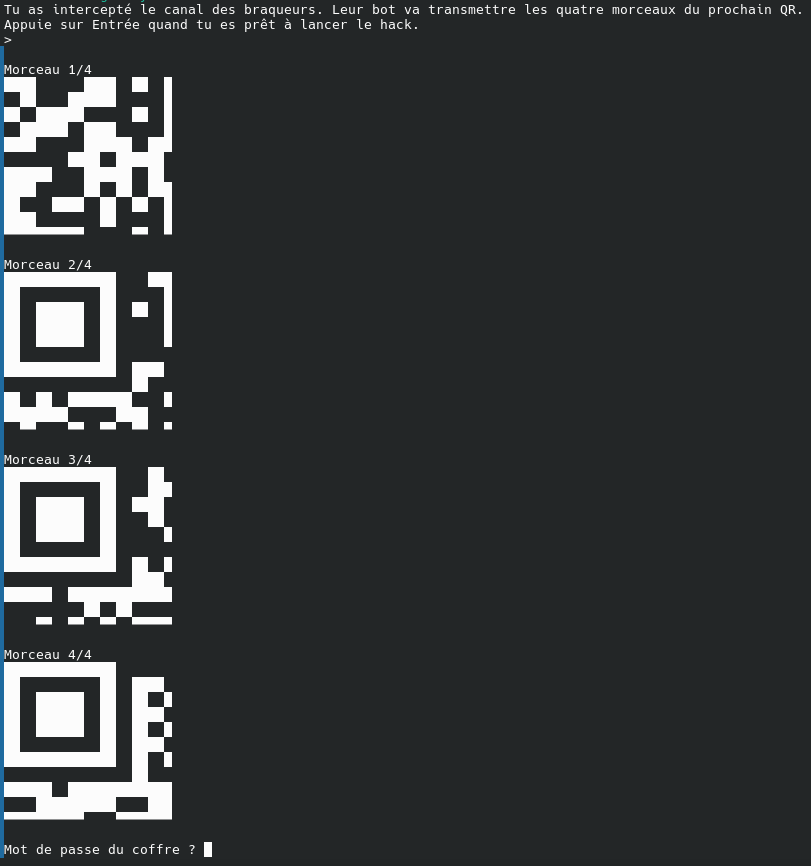
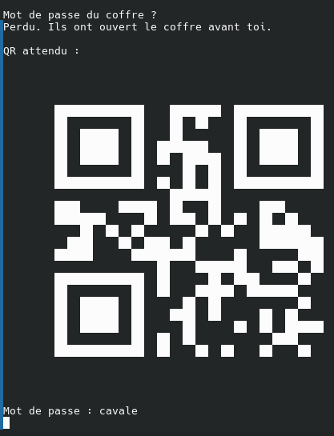
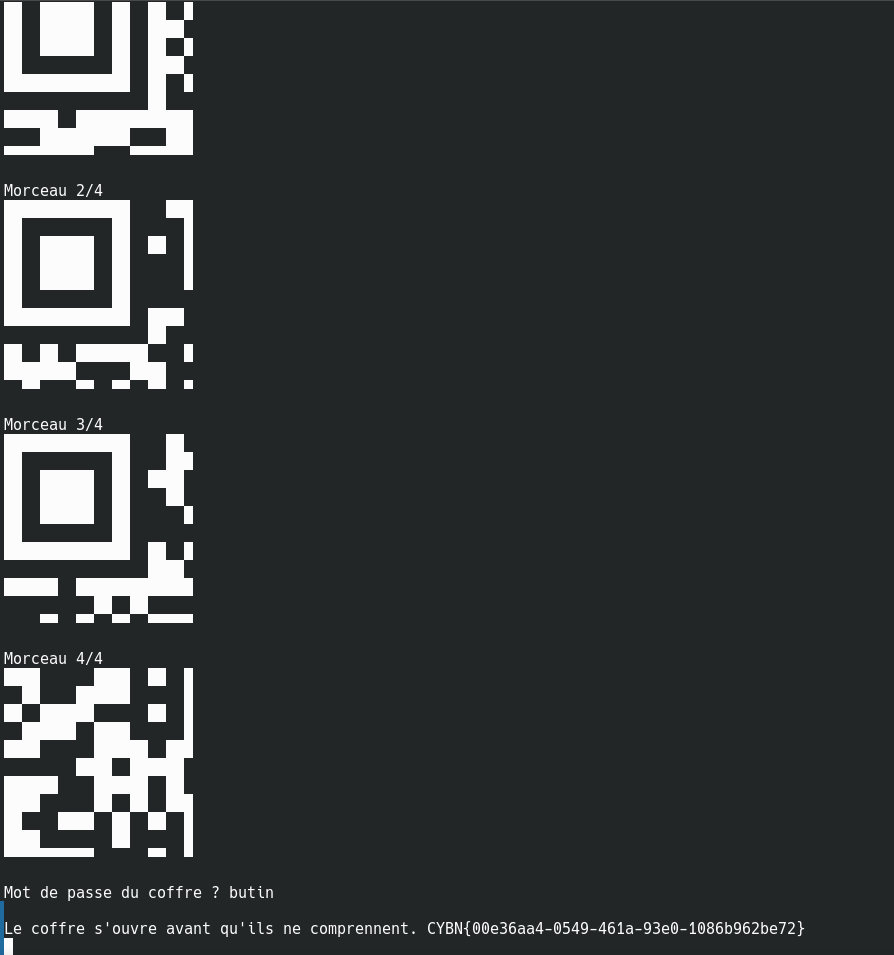

# Titre du challenge

__*Catégorie :*__ (REVERSE, CRYPTO, WEB, ...)  
__*Difficulté :*__ Easy  
__*Flag :*__ `CYBN{00e36aa4-0549-461a-93e0-1086b962be72}`  

> Description  
> Quatre braqueurs ont imprimé le QR contenant le mot de passe à usage unique d'un coffre. Ils ont coupé la feuille en quatre et se sont partagé les morceaux, persuadés qu'aucun d'eux ne pourrait partir seul avec le butin.
> 
> Grand hacker que vous êtes, vous avez réussi à intercepter leurs communications. Vous avez trois secondes pour retrouver le mot de passe et l'utiliser avant qu'ils ne reconstituent le QR et ouvrent le coffre.
> 
> Format du flag : CYBN{...}


---

## Partie 1 
Le challenge nous indique de nous connecter à une instance via 
```
nc challenges.cybn.fr 10168
```

À partir de là, on reçoit :


Il faut rentrer un mot de passe en quelques secondes sinon le délai est écoulé et il apparaît accompagné du QR Code reconstitué :


## Partie 2
Après quelques tests, on voit que les mots de passe sont une liste de mots bien définis et qu'ils reviennent tout le temps, il suffit donc d'essayer plusieurs fois d'en rentrer un jusqu'à ce que ça passe, ici après 6 essais avec le mot de passe "butin" :
