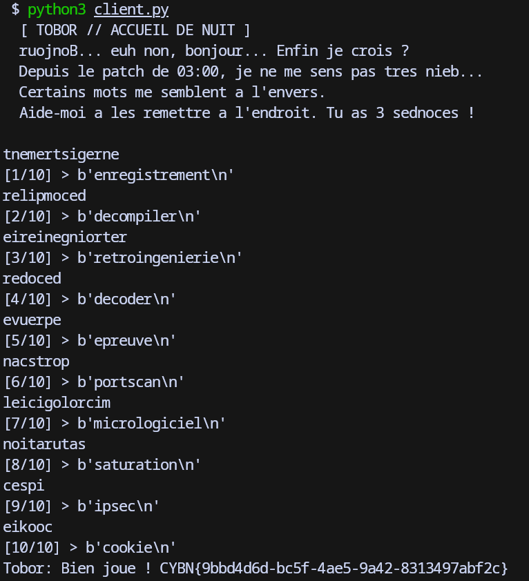

# La réponse elle est vite retournée

__*Catégorie :*__ PROG  
__*Difficulté :*__ Intro  
__*Flag :*__ `CYBN{9bbd4d6d-bc5f-4ae5-9a42-8313497abf2c}`  

> Description  
>   Un étudiant a tenté de réparer le robot de l'accueil à 3 h du matin. Depuis, il parle à l'envers et n'a aucune patience. Il va t'envoyer 10 mots, un par un : renvoie chacun dans l'autre sens. Tu as 3 secondes pour toute la conversation.  
> Un client Python minimal est fourni. Complète `HOST` et `PORT` avec les informations de connexion de ton instance.  
> Format du flag : `CYBN{...}`

---

On démarre l’instance et on lit le script fourni. Celui-ci ne fait rien de sorcier :
- ouvre un socket et se connecte au serveur en utilisant les variables HOST et PORT ;
- décode et affiche les données envoyées par le serveur ;

```python
import socket

HOST = "A_COMPLETER"
PORT = 0  # A_COMPLETER

def recv_until(sock, marker):
    data = bytearray()
    while not data.endswith(marker):
        chunk = sock.recv(1)
        if not chunk:
            break
        data.extend(chunk)
    return data.decode("ascii")

def main():
    with socket.create_connection((HOST, PORT), timeout=5) as sock:
        for _ in range(10):
            message = recv_until(sock, b"> ")
            print(message, end="")
            if not message.endswith("> "):
                return
            word = message.splitlines()[-2]
            # Exemple d'envoi : sock.sendall(b"reponse\n")
            # Exemple de lecture : sock.recv(1024)
            # A toi de repondre au robot avant le mot suivant.
        print(recv_until(sock, b"\n"), end="")

if __name__ == "__main__":
    main()
```

Le challenge repose sur un petit trick du langage python qui permet d’inverser facilement et rapidement une chaîne de caractères : `string[::-1]`

On peut donc ajouter notre propre fonction, qui s’occupera au passage de la conversion en octets :

```python
def rev_word(string: str) -> bytes:
    return bytes((string[::-1] + "\n") , "utf-8")
```

*NOTE: ici, j’ai perdu un peu de temps avant de comprendre qu’il fallait également que je renvoie un caractère newline (`\n`).*   

Enfin, on modifie la boucle `for` dans la fonction `main` pour modifier et renvoyer le mot reçu :  

```python
def main():
    ...
    word = message.splitlines()[-2]
    response = rev_word(word)
    sock.sendall(response)
    ...
```

On obtient alors le flag après avoir renvoyé correctement tous les mots du robot :  


