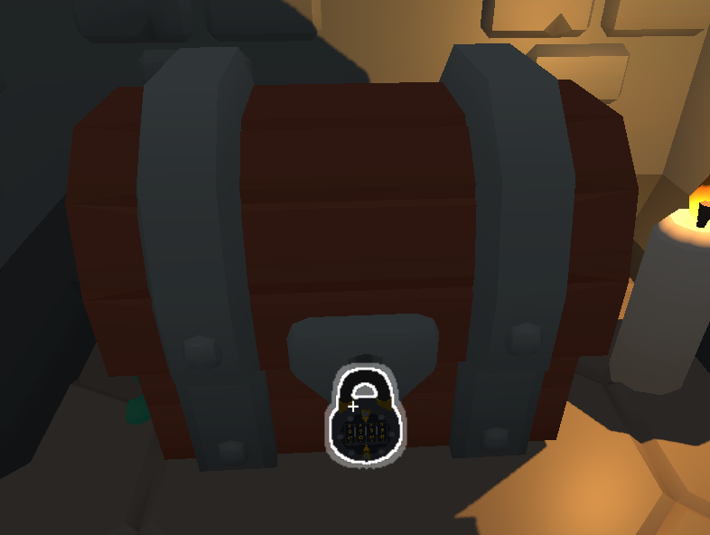
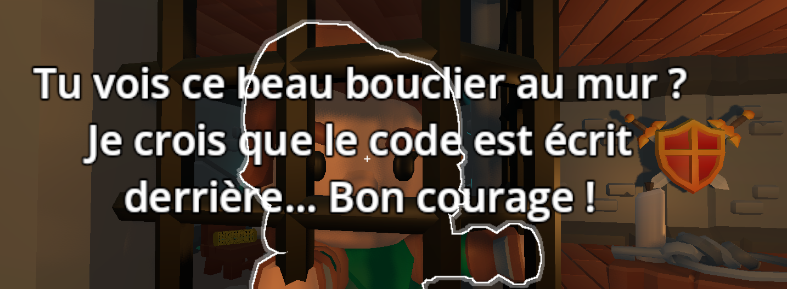
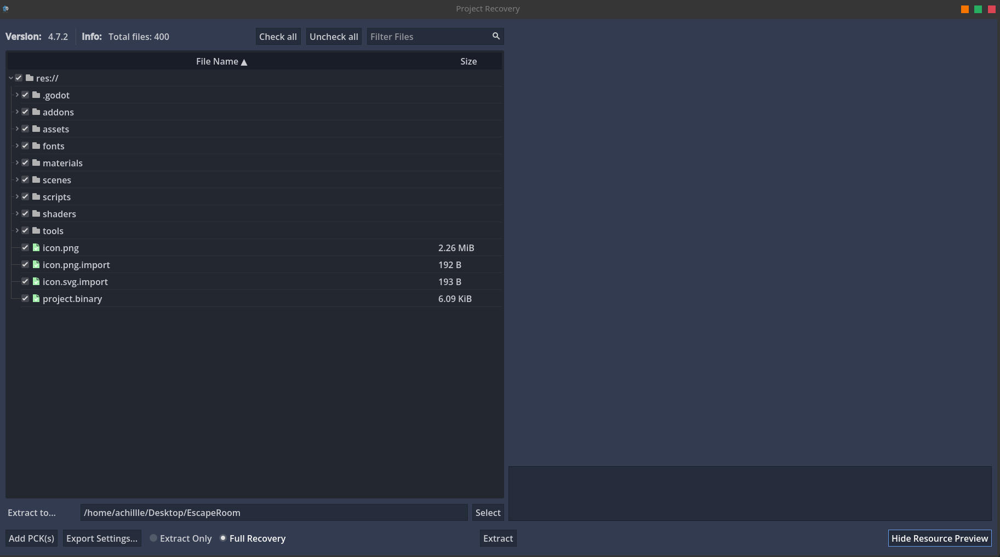
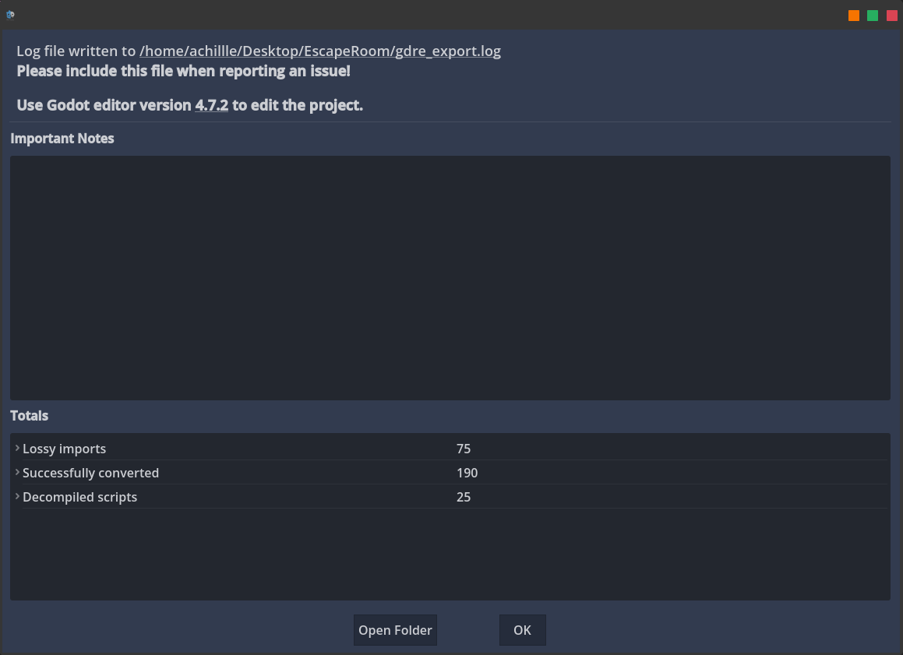
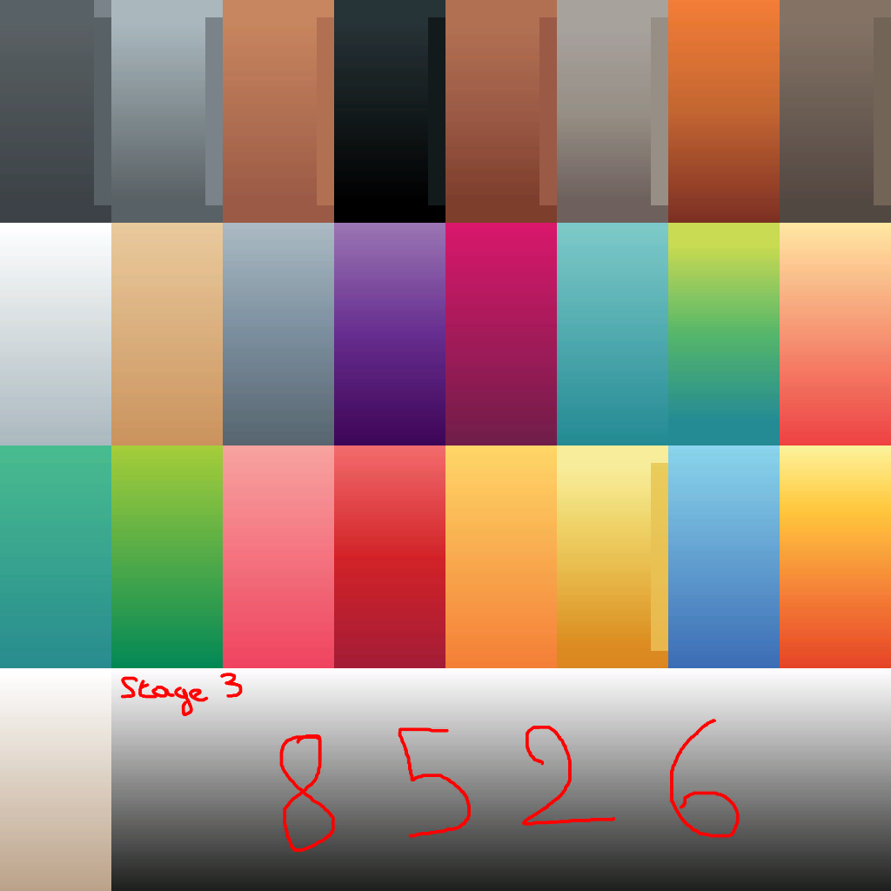
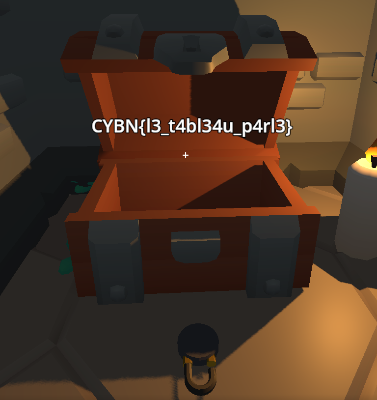

# Code bien caché

__*Catégorie :*__ REVERSE  
__*Difficulté :*__ Medium  
__*Flag :*__ `CYBN{l3_t4bl34u_p4rl3}`  

> Description  
> Le prochain code serait caché quelque part dans la pièce. Tu as pourtant inspecté chaque mur sans rien voir. Le prisonnier te conseille de ne pas juger un bouclier à sa seule façade.
> 
> Format du flag : CYBN{...}


---

## Partie 1

In-game, une nouvelle salle s'ouvre avec un nouveau coffre et le PNJ nous donne un indice sur l'endroit où chercher :




## Partie 2

On extrait les ressources du jeu via [GDRE](https://github.com/GDRETools/gdsdecomp), tool permettant de décompiler et d'extraire les ressources d'un jeu Godot non protégé :
```
❯ ./gdre_tools.x86_64
```

Puis dans RE tools > recover project > EscapeRoom.exe


On peut exporter les fichiers extraits


## Partie 3

On cherche "shield" dans les fichiers extraits :
```
❯ find . -name "*shield*"  2>/dev/null

...
./EscapeRoom/addons/kaykit_dungeon_remastered/swords_shield_gold_dungeon_texture.png
...
```

## Partie 4

Le fichier `./EscapeRoom/addons/kaykit_dungeon_remastered/swords_shield_gold_dungeon_texture.png` est :


## Partie 5

On utilise ce code pour dévérouiller le second coffre et on obtient le flag :
