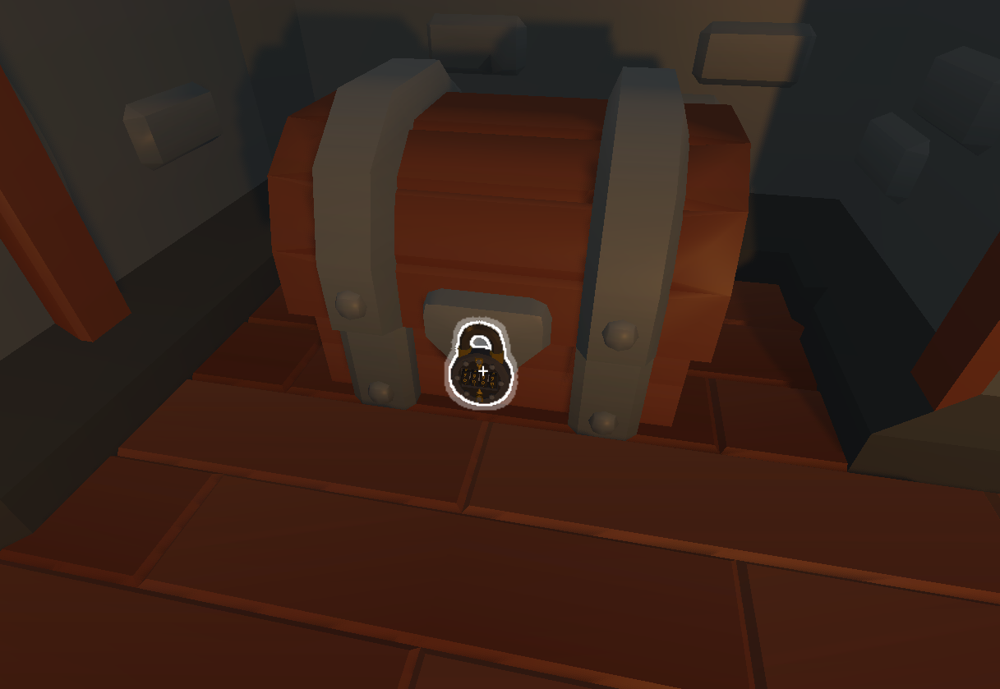
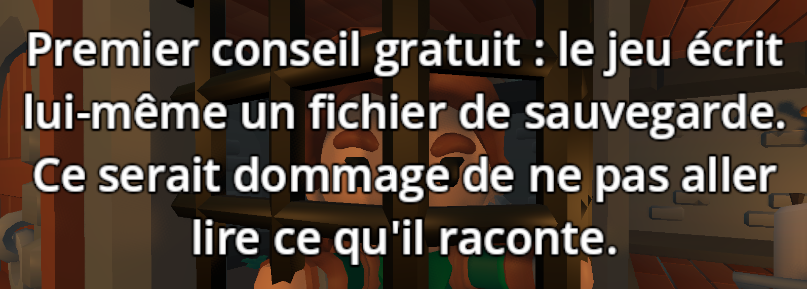
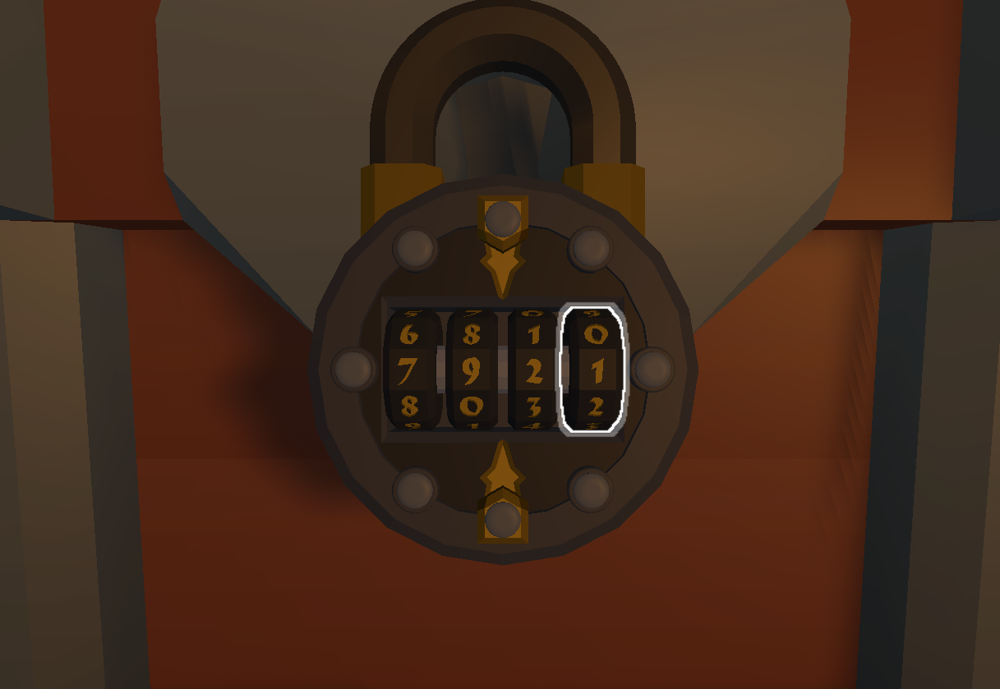
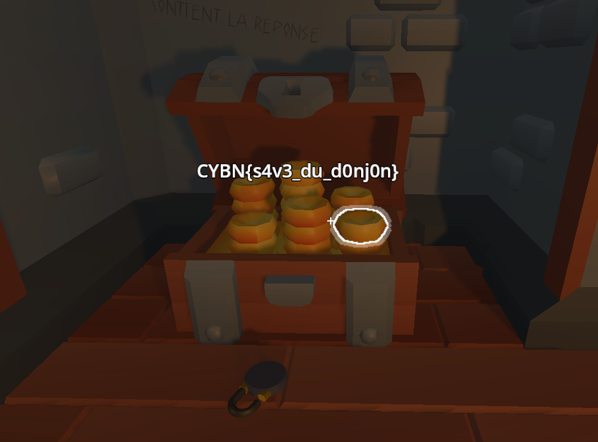

# Donjon Escape - Fichier de sauvegarde

__*Catégorie :*__ REVERSE  
__*Difficulté :*__ Intro  
__*Flag :*__ `CYBN{s4v3_du_d0nj0n}`  

> Description  
> Le roi codeur a créé Donjon Escape pour prouver que personne ne peut sortir de son donjon. Quatre épreuves te séparent de la liberté. Un prisonnier bavard t'accompagne, mais ses conseils sont aussi fiables que les promesses du roi. Chaque victoire ouvre la voie à l'épreuve suivante.
>
> Le roi codeur prétend que son premier cadenas est inviolable. Le prisonnier, lui, trouve les fichiers de sauvegarde du jeu bien plus intéressants que les serrures. Qui des deux faut-il écouter ?
>
> Lance l'exécutable Windows fourni. Format du flag : CYBN{...}


---

## Partie 1 

Lancer le jeu via [wine](https://www.winehq.org/), tool permettant d'exécuter des applications Windows sur d'autres systèmes (ici, Linux) :
```
❯ wine EscapeRoom.exe
``` 

## Partie 2

On trouve le coffre avec lequel on peut intéragir :


Le PNJ nous donne un indice :


## Partie 3

On trouve la sauvegarde dans `~/.wine/drive_c/users/user/AppData/Roaming/Godot/app_userdata/EscapeRoom/savegame.json`

```
❯ cat ~/.wine/drive_c/users/user/AppData/Roaming/Godot/app_userdata/EscapeRoom/savegame.json

{
        "pin_1": "7921",
        "session_id": "f2999953fb7e2ee582506473c9a3cde385e176bd973b59f5e3adfb4fbd18f9fc",
        "version": 1
}
```

## Partie 4

On entre le pin trouvé dans la sauvegarde dans le cadenas du coffre et le flag apparaît :


