# Donjon Escape - Offrande impossible

__*Catégorie :*__ REVERSE  
__*Difficulté :*__ Easy  
__*Flag :*__ `CYBN{1_m1ll10n_d3_p13c3s}`  

> Description  
> Pour gagner la faveur du roi, la statue réclame un million de pièces. Une par une. Le prisonnier a déjà abandonné l'idée de t'aider à les porter.
>
> Format du flag : CYBN{...}


---

## Partie 1

Le coffre ouvert précédemment nous permet de récupérer des pièces une par une et de les déposer à la statue (le compteur de pièce est juste sa droite). On doit en déposer 1 000 000 pour avoir le flag.
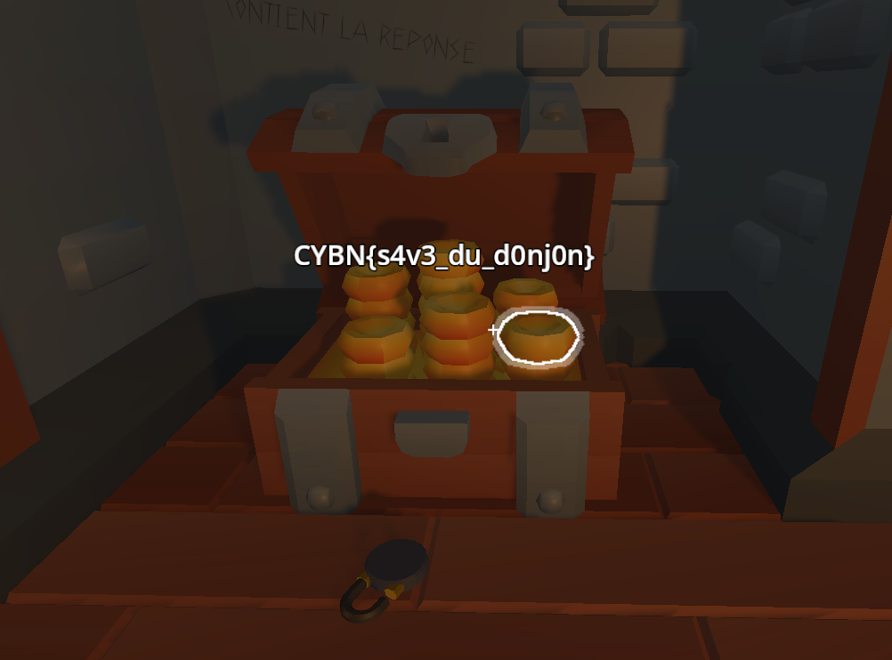
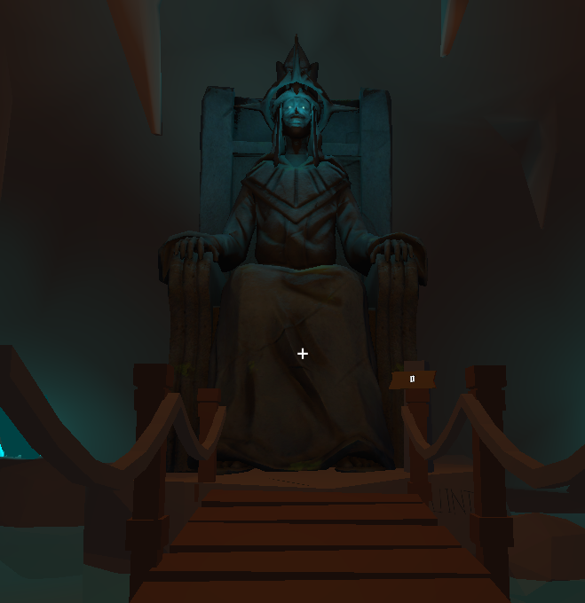

## Partie 2

On lance [cheatengine](https://www.cheatengine.org/), tool d'analyse et de manipulation de mémoire utilisé notamment pour les cheats :
```
sudo ./cheatengine-x86_64
```
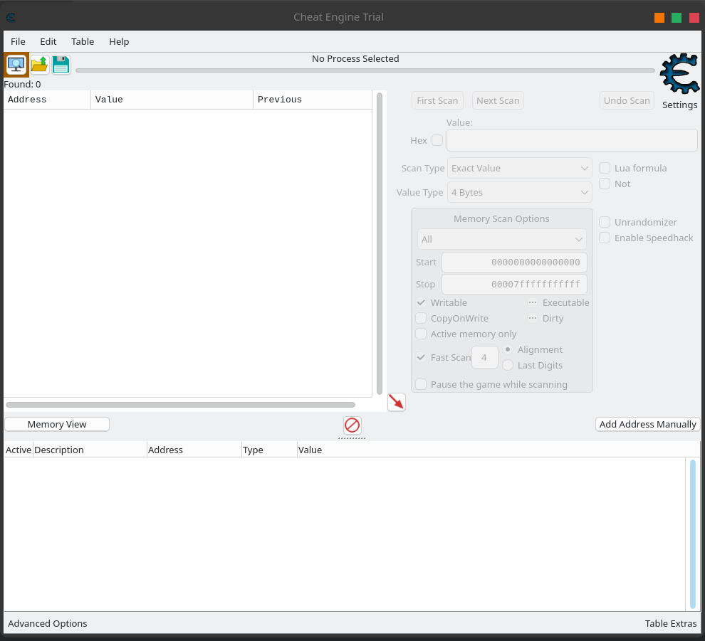

On sélectionne le process EscapeRoom.exe à analyser/manipuler :
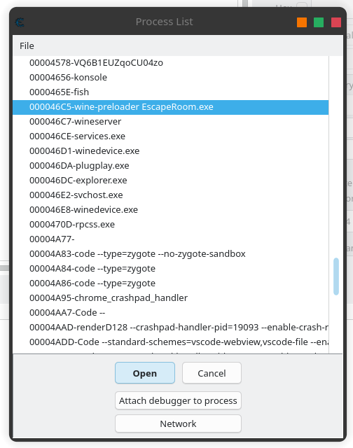


## Partie 3

Dans cheatengine, afin de repérer la variable à override pour que sa valeur dépasse 1 000 000 :
- on donne par exemple 3 pièces à la statue 
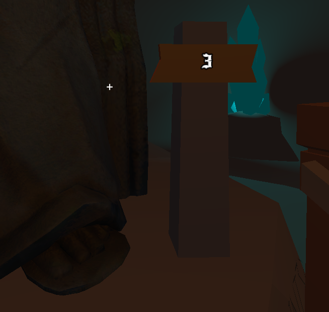
- on scan une première fois l'espace mémoire du processus du jeu pour trouver les variables avec une valeur de 3
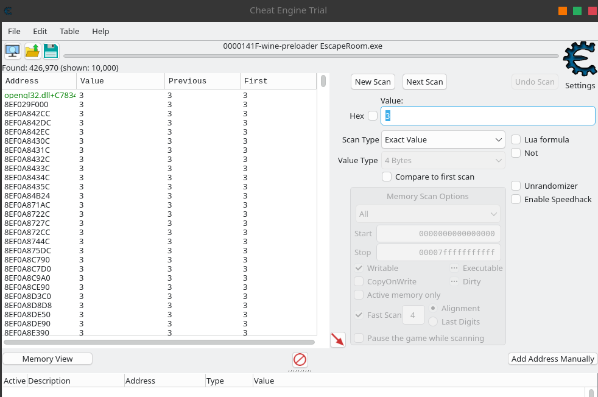
- in-game, on repose par exemple 3 pièces pour arriver à 6
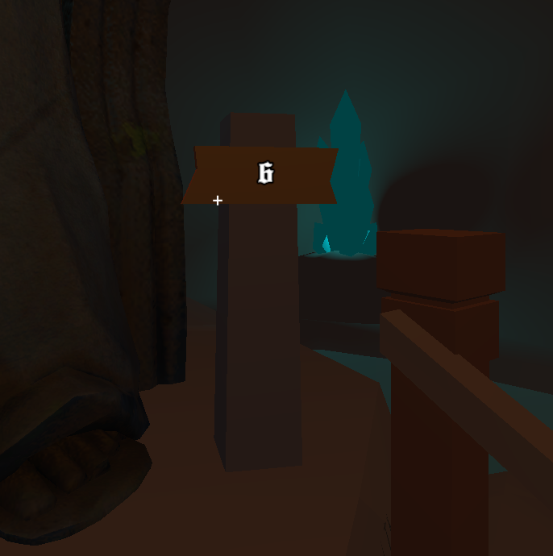
- on scan de nouveau en filtrant avec la valeur 6 et en comparant au first scan
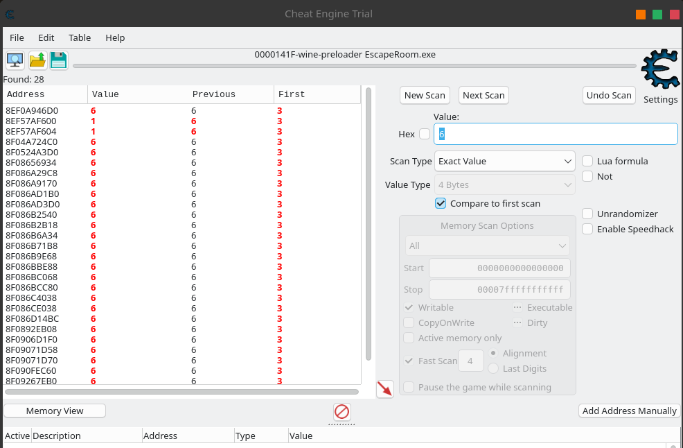
- on répète ce processus pour 9 par exemple
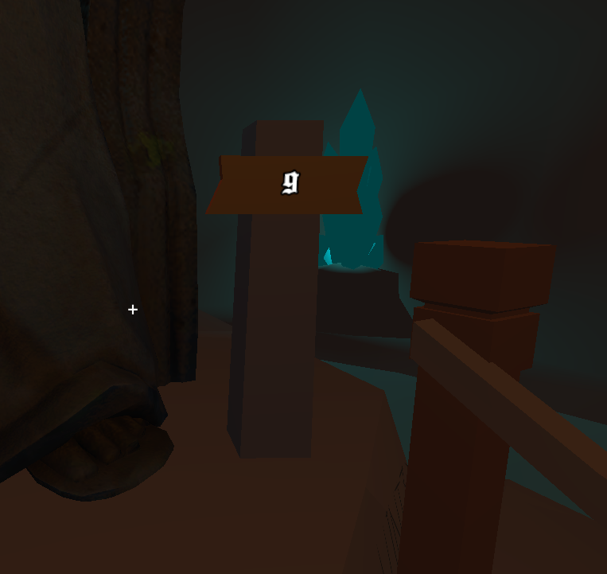
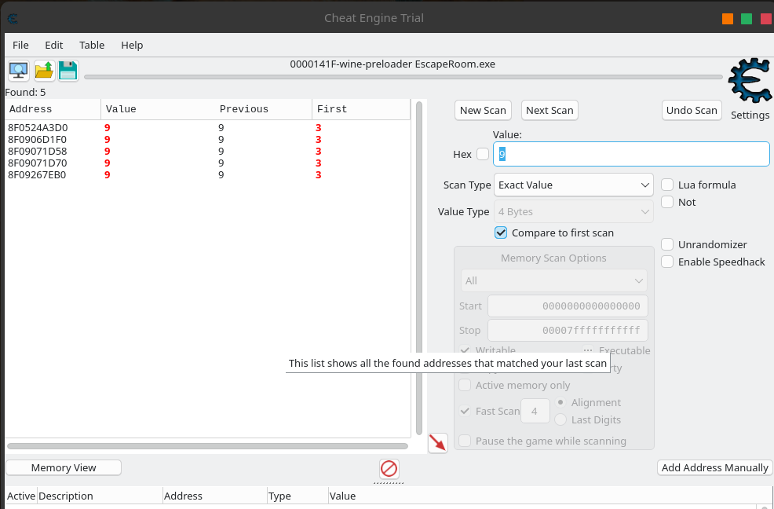
- une fois la liste de variables suffisamment réduite, on modifie leur valeur à 1 500 000 par exemple
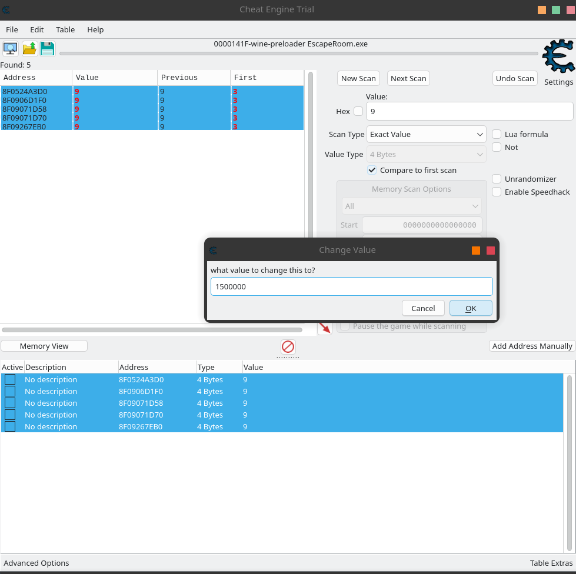
- la tête de la statue tombe et le flag apparaît
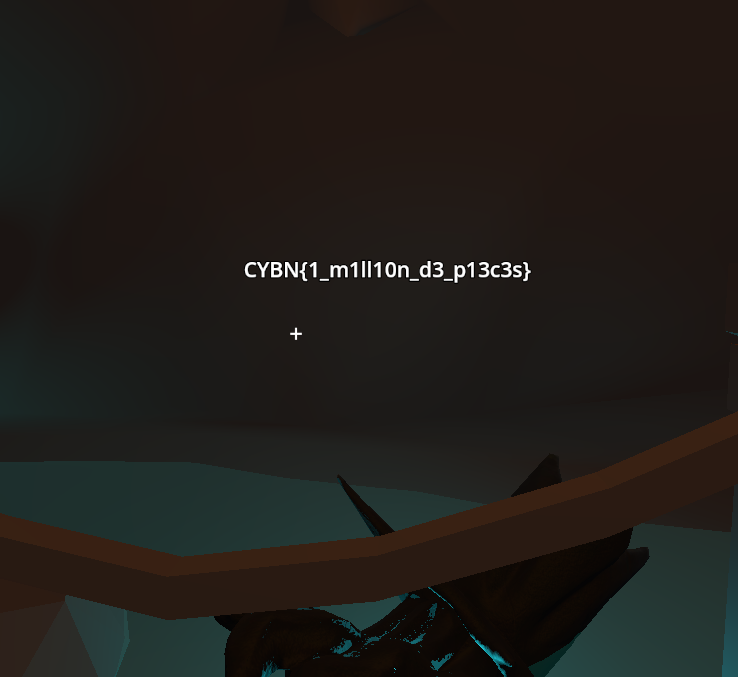