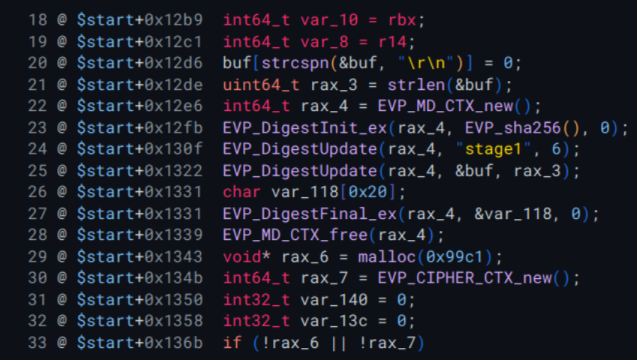
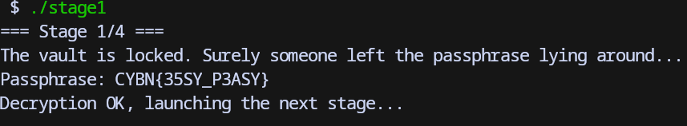
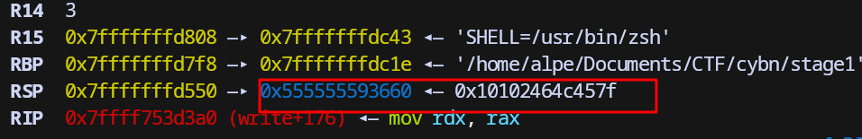
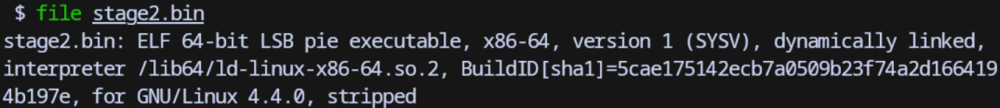
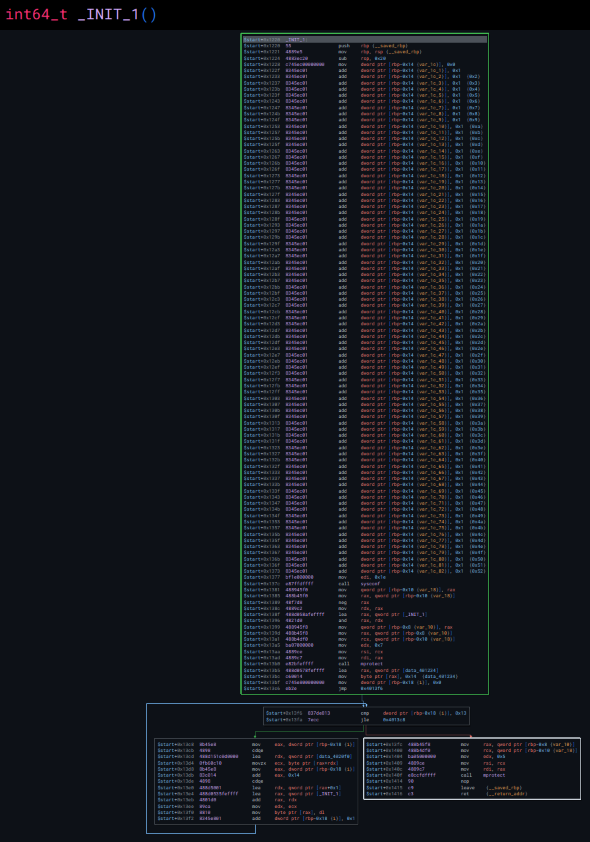
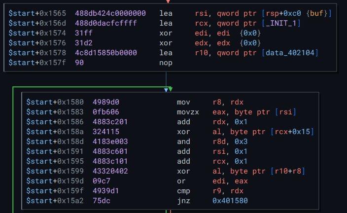
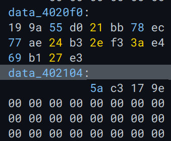
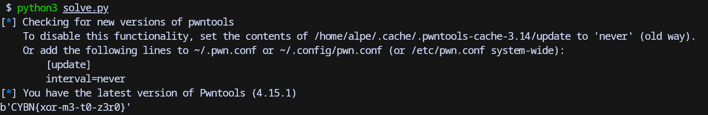
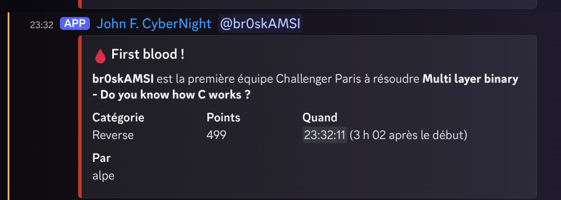

# Multi Layer Binary - Do you know how C works ? 

__*Catégorie :*__ REVERSE  
__*Difficulté :*__ Easy  
__*Flag :*__ `CYBN{xor-m3-t0-z3r0}`

> Description  
> Maintenant que tu as réussi à trouver le premier flag, bon courage pour trouver le second. Mais avant cela, est-tu même capable de récupérer le binaire ? Format du flag : `CYBN{...}`

---

## Analyse du stage1
Le binaire fourni dans la partie 1 de ce challenge est chargé de déchiffrer le deuxième stage une fois le mot de passe trouvé.

Pour ce faire, il fait appel aux librairies [EVP d’OpenSSL](https://wiki.openssl.org/index.php/EVP) pour calculer la clef de déchiffrement AES à partir d’un hash sha256, tel que `sha256("stage1" + user_input)`.  


Si user_input est correct, c’est à dire s’il correspond au flag trouvé dans le stage précédent, alors la routine de déchiffrement AES-256-GCM peut continuer. Lorsque celle-ci se finit correctement, le binaire crée un file descriptor en mémoire avec `memfd_create`, puis y écrit les données déchiffrées (`write`). Enfin, un appel à `fexecve` permet d’exécuter le second stage du challenge.

```C
0040148f    if ((uint32_t)var_160_1)
0040148f    {
00401495        *(uint8_t*)((char*)rax_6 + 0x99c0) = 0;
004014a3        puts("Decryption OK, launching the next stage...\n");
004014b1        int32_t fd = memfd_create("stage", 0);
004014b6        int64_t i = 0;                 
...
004014f4        do
004014f4        {
004014d7            ssize_t rax_18 = write(fd, (char*)rax_6 + i, 0x99c0 - i);         
...
004014ea            i += rax_18;
004014f4        } while (i <= 0x99bf);
...
00401558        uint128_t argv_1 = argv_2;
00401564        int64_t var_128 = 0;
00401569        fexecve(fd, &argv_1, __environ);
00401569    }
```




## Dump du stage2
Nous savons maintenant comment fonctionne ce binaire, et deux choix s’offrent alors à nous:  
- Créer un script d’extraction du stage2 qui calculerait la clef et les offsets, déchiffrerait le second binaire puis l’écrirait dans un fichier ;
- Dumper le fichier directement depuis la RAM, avec GDB ou `/proc/{stage2-pid}/exe`.  

La deuxième solution étant la plus simple, c’est celle-ci que nous allons utiliser.

Lors du CTF, j’ai remarqué qu’il semblait y avoir un mécanisme d’anti-debug / d’intégrité du binaire puisque la soumission d’un mot de passe valide ne fonctionnait pas sous GDB.

J’ai privilégié l’utilisation de catchpoints pour arrêter l’execution lorsque des appels systèmes à `write` étaient effectués, puisque ceux-ci contiendraient forcément l’adresse du buffer source contenant le binaire déchiffré.

Un simple `catch syscall write` et quelques itérations permettent de localiser l’adresse du buffer (on peut même y remarquer les octets `0x454c46`, soit `ELF`) 


Enfin, la commande `dump memory stage2.bin addresse_binaire addresse_binaire+taille_du_stage2` permet de récupérer la partie 2 du challenge (la taille étant passée comme argument lors de l’appel à write).

Petite vérification du dump avec `file`, on semble avoir bien fait les choses  


## Analyse du stage2 et récupération du flag

L’analyse statique de ce second binaire révèle une logique plutôt similaire:  
- on récupère l’entrée utilisateur ;
- on fait une tambouille avec, puis on utilise le résultat pour générer la clef `sha256("stage2" + user_input)` ;
- on déchiffre puis exécute le stage3 en mémoire si la clef est correcte.  

Ce deuxième stage contenait une fonction appelée `_INIT_1` par mon Binja, contenant beaucoup d’instructions `add` et des appels aux fonctions `sysconf` et `mprotect`.  


Plutôt que de l’analyser de façon statique, j’ai décidé (par pure fénéantise) d’utiliser gdb pour observer la logique menant à un accès valide ou non. Cela m’a permis d’isoler le bout de code ci-dessous qui :  
- charge l’adresse du buffer contenant l’entrée utilisateur ;
- charge l’adresse de la fonction `_INIT_1` ;
- charge l’adresse de 4 octets présents dans la section `.rodata` ;
- itère sur l’entrée utilisateur et sur ces octets en réalisant des opérations `xor`.

La logique de comparaison de mot de passe repose ici sur l’opération `or` à $start+0x159d, qui vérifie si résultat est égal à 0 après les deux `xor`.  


Avec gdb, j’ai confirmé que les deux opérations `xor` s’appuyaient sur les deux séquences d’octets ci-dessous :  


Le XOR étant réversible, de telle sorte que `A ^ B = C` et `B ^ C = A`, il nous est alors facile de récupérer le flag en écrivant un petit script python :  
```python
import pwn

xor_flag = b"\x19\x9a\x55\xd0\x21\xbb\x78\xec\x77\xae\x24\xb3\x2e\xf3\x3a\xe4\x69\xb1\x27\xe3"
key = b"\x5a\xc3\x17\x9e"

print(pwn.xor(xor_flag, key))
```


Encore un first blood !


