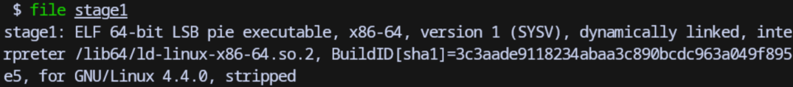
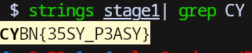
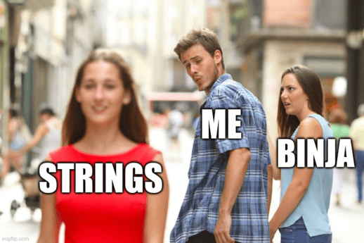
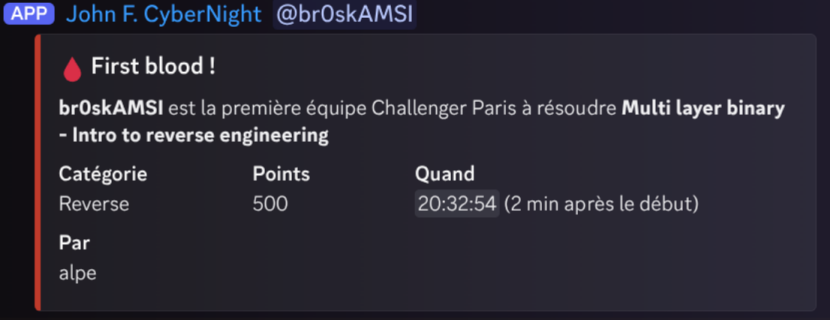

# Multi Layer Binary - Intro to reverse engineering

__*Catégorie :*__ REVERSE  
__*Difficulté :*__ Intro  
__*Flag :*__ `CYBN{35SY_P3ASY}`  

> Description  
> Description du challenge

---

## Analyse sommaire et récupération du flag
On nous fourni un seul binaire à télécharger. Un rapide `file` dessus nous indique à quoi nous avons affaire :  

Étant donné que c’est un chall d’intro, je sais que je vais devoir faire appel au meilleur outil de rétro-ingéniérie : `strings` !  

First blood, 2 minutes après le début du CTF !  

