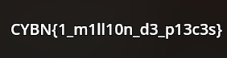

# Offrande impossible

__*Catégorie :*__ REVERSE  
__*Difficulté :*__ Easy  
__*Flag :*__ `CYBN{1_m1ll10n_d3_p13c3s}`  

> Description  
> Pour gagner la faveur du roi, la statue réclame un million de pièces. Une par une. Le prisonnier a déjà abandonné l'idée de t'aider à les porter.
>
> Format du flag : CYBN{...}


---

## Partie 1

Le coffre ouvert précédemment nous permet de récupérer des pièces une par une et de les déposer à la statue. On doit en déposer 1 000 000 pour avoir le flag.

On lance [cheatengine](https://www.cheatengine.org/), tool d'analyse et de manipulation de mémoire utilisé notamment pour les cheats :
```
sudo ./cheatengine-x86_64
```

TODO add photo

## Partie 2

Dans cheatengine, afin de repérer la variable à override pour que sa valeur dépasse 1 000 000 :
- on scan une première fois l'espace mémoire du processus du jeu
- in-game, on récupère une pièce et on la dépose
- on scan de nouveau en filtrant par valeur ayant augmentée
- on répère ce processus jusqu'à avoir suffisamment discriminé les variables
- une fois la liste de variables suffisamment réduite, on modifie leur valeur à 2 000 000

TODO add photo

## Partie 3

De retour dans le jeu, le flag apparaît :
