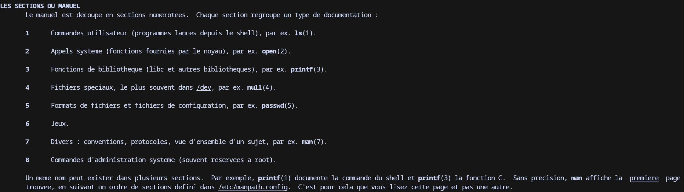
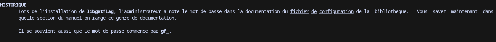
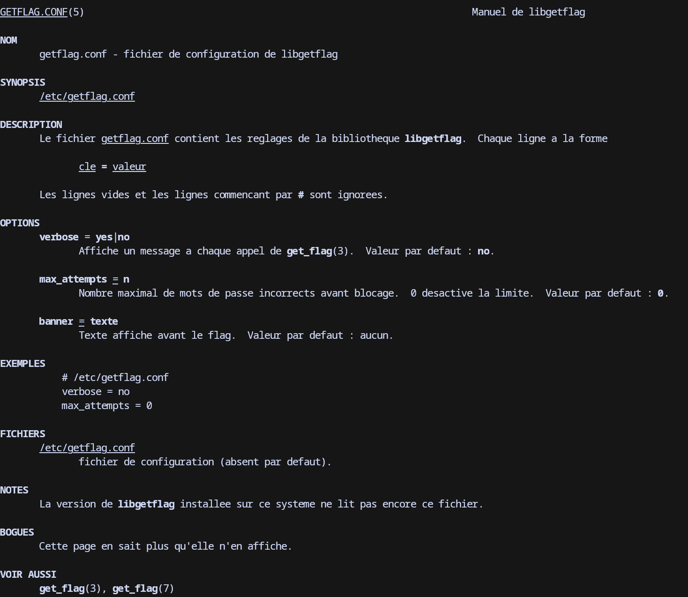
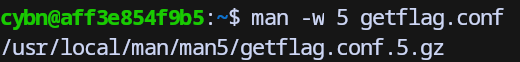
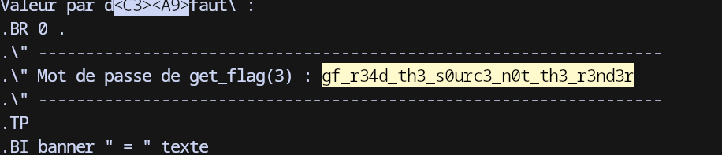
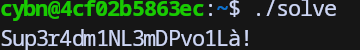
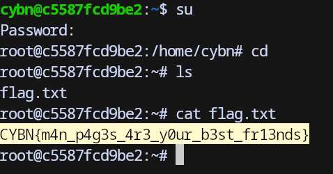

# RTFM

__*Catégorie :*__ SYSTEM  
__*Difficulté :*__ Intro / Easy ?  
__*Flag :*__ `CYBN{m4n_p4g3s_4r3_y0ur_b3st_fr13nds}`  

> Description  
> Quelque chose comme "Lire les manpages de la librairie getflag"

---

On lance une instance et on s’y connecte avec SSH.

## Lecture des manpages
Une fois connecté, on lance naïvement un `man getflag`. On nous y explique que c’est bien tenté, mais que ce n’est pas un programme. D’autres informations à propos des sections du manuel nous sont donc fournies :  


On va donc lire la page 3 du manuel `man 3 getflag`, et on y trouve un hint sur ce qu’il faut chercher.


On peut donc utiliser la commande `man -K gs_ -s 5` pour chercher la chaîne de caractères "gs_" dans les pages concernant les fichiers de configuration (section 5). 


On comprend donc qu’il faut regarder dans les commentaires pour y trouver le mot de passe. Il faut d’abord trouver où la page se situe avec `man -w 5 getflag.conf` :  


On le copie dans le dossier de notre utilisateur, puis on peut le lire après l’avoir décompressé :  


Une fois ce mot de passe récupéré, on peut copier le code C fourni dans la page 3 du manuel et l’y insérer.

```c
#include <errno.h>
#include <stdio.h>
#include <stdlib.h>
#include <string.h>

#include <get_flag.h>

int main(void)
{
    char flag[128];

    if (get_flag("gf_r34d_th3_s0urc3_n0t_th3_r3nd3r", flag, sizeof(flag)) == -1) {
        fprintf(stderr, "get_flag: %s\n", strerror(errno));
        return EXIT_FAILURE;
    }

    printf("%s\n", flag);
    return EXIT_SUCCESS;
}
```

Après compilation, on récupère le mot de passe de l’utilisateur `root` :  


Il suffit ensuite d’afficher le flag  

